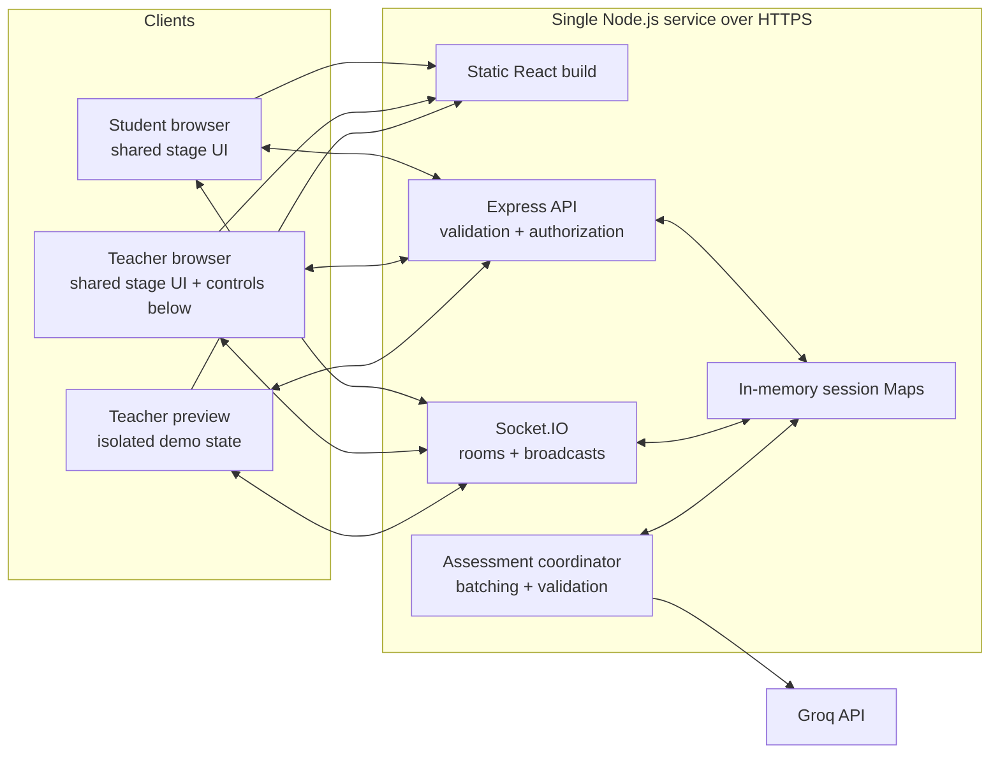

# Words Connect — System Architecture

## Architecture summary

Use a React + Vite + Tailwind client and a Node.js + Express + Socket.IO server in one deployable service. Zod or equivalent validates API, socket, and AI payloads. The server owns the single active workshop session and stores it in memory. Opening the main application link enters the teacher interface directly; there is no password, access code, or permanent teacher account. The browser receives a session-scoped capability for teacher controls. Student QR/link joins remain a separate name-entry flow and receive only participant identity and reconnect credentials. There is no multi-session management, database, or recovery after process restart. The same origin serves the built client and realtime/API endpoints through HTTPS.

## Frontend architecture

- **Application shell:** mode-aware routing, connection status, session context, and stage navigation.
- **Shared stage renderer:** renders the same student-facing activity for students and live teacher. It receives a safe public stage snapshot and emits participant actions.
- **Teacher control panel:** conditionally rendered immediately after the stage renderer only for authorized live teacher mode. It contains controls for the current stage; no side panel or floating controls.
- **Preview controller:** enters a labeled demo environment and uses demo fixtures/local isolated state. Preview requests never reach live submission or assessment endpoints.
- **Realtime client:** subscribes to authorized stage snapshots and updates, retries connections, and resumes using the session-scoped reconnect token.
- **Result views:** expose individual and leaderboard data only after server publication state allows it.

## Backend responsibilities

- **Session service:** lifecycle, stage/activity state, joining gate, pause/resume, ending, and explicit clear behavior.
- **Identity/auth service:** issues a session-scoped teacher capability on main-link entry and validates that capability and participant reconnect tokens; derives role from the server-authorized connection flow, not request fields. Student QR joining never returns a teacher capability.
- **Participant service:** assigns stable participant IDs and session display numbers, handles reconnects, and reports student counts.
- **Activity services:** enforce Wall, quiz, and writing rules; preserve source and response separately; reject changes after closure.
- **Realtime gateway:** authenticates sockets, scopes rooms, validates event payloads, and broadcasts only role-appropriate data.
- **Assessment coordinator:** selects eligible student submissions, sends batches of about five to Groq, validates keyed responses, records per-item status, and retries failed batches idempotently.
- **Export service:** generates teacher-authorized CSV and JSON from current in-memory state.

## Shared stage interface and mode boundaries

Three modes are explicit in client state and server authorization:

| Mode | Identity and state | Allowed effects |
|---|---|---|
| Student | Session participant ID + reconnect credential | Own submissions; approved public activity data; own published result and published leaderboard |
| Live teacher | Teacher capability scoped to session | Stage/activity control, moderation, teacher demonstration actions, evaluation, corrections, publication, export/end |
| Preview | Separate demo ID and fixtures | Demo interactions only; no live API mutation, participant registration, student count, Groq call, score, or leaderboard effect |

Live teacher activity must be stored as teacher-originated or transient demonstration state and excluded from student participant and assessment collections. The backend rejects student calls to teacher actions even if the client manually crafts requests. Preview should use a separate route/service namespace and data store from the live session; preview state is never passed to the assessment coordinator.

## In-memory data management

Keep one active `SessionState` in memory, with maps/collections for participants, activities, submissions, assessment results, and credentials. Do not add multi-session selection/management. Use stable opaque IDs. Mutable state transitions and duplicate checks occur in one server-side operation before acknowledgement/broadcast. Store the accepted submission per defined exercise; preserve original response and source snapshot. A missing response at exercise closure is a zero-mark outcome, not a Groq request. A failed assessment is retried; if it remains unresolved, publication is blocked until the teacher resolves it. Process restart loses all data by design.

## Socket.IO communication

Use authenticated session-scoped rooms, with role-specific rooms or server-filtered snapshots. Treat sockets as delivery channels, not authority. Every mutating event validates identity, ownership, lifecycle and activity-open state, payload schema, and idempotency/duplicate policy. See `04-DATA-MODELS-AND-EVENTS.md` for event contracts.

## Groq integration

Only the backend holds the Groq key. The assessment worker sends eligible student work with stable participant and exercise IDs, fixed sources, rubric instructions, and explicit instruction to treat student text as untrusted quoted content. Request structured JSON. Validate identity sets and score ranges before storing any result. Do not correlate results by array position. Ambiguous or invalid outputs receive a flagged status for teacher inspection; retry only failed items/batches without overwriting successful results.

## Security and authorization

- Establish teacher authority when the main application link is opened by issuing a protected session capability; never accept a role string from the browser as proof. Student QR joining issues participant credentials only. No password, access code, or permanent teacher account is used.
- Bind participant reconnect credentials to one session participant and verify ownership on each submission/result request.
- Keep author IDs private for anonymous Wall display; teacher moderation may resolve them through an authorized action.
- Validate session IDs, participant IDs, event schemas, activity state, payload sizes, and allowed transitions.
- Redact secrets and avoid logging raw student content or credentials unnecessarily.
- Keep preview IDs and data segregated and never authorize preview credentials for live APIs.
- Enforce publication gates on the server for individual results and leaderboard endpoints/events.

## Deployment architecture

Build React assets and package them with one Node.js service. Express serves static assets and HTTP endpoints; Socket.IO attaches to the same HTTPS-facing server. Deploy on Render as preferred, with TLS/public access so students can use Wi-Fi or mobile data. Configure the Groq key as a server-side environment secret. No separate frontend host or database is required.

## Component responsibilities

| Component | Responsibility |
|---|---|
| Stage renderer | Student-facing activity surface shared by student and live teacher |
| Teacher controls | Authorized controls directly below current activity |
| Preview environment | Isolated, visibly labeled demo journey and sample data |
| Express routes | Authenticated request/response operations and exports |
| Socket gateway | Authenticated real-time updates and acknowledgements |
| Session/activity services | Authoritative lifecycle, validation, and in-memory state changes |
| Assessment coordinator | Groq batching, retries, response validation, and result storage |
| Export service | Teacher-requested CSV/JSON generation |

## Implemented session foundation (Task 004)

The current server exposes `POST /api/sessions/teacher-entry` (opens or creates the sole in-memory session and issues a session-scoped teacher capability), `GET /api/sessions/:sessionId` (safe public joining/lifecycle snapshot), and `GET /api/sessions/:sessionId/teacher` (capability-protected teacher snapshot). Student QR joining uses the participant join flow and cannot attach as a teacher. A process can hold one session; an ended session remains in memory and prevents another from being created until restart. Restart loses the session and all issued tokens.

Sockets initially connect as session-scoped guests. They must use `session:join` with a name and UUID request ID, `session:resume` with their reconnect token, or `session:teacher-attach` with the teacher capability before receiving the corresponding identity. Students can join while the gate is open, including after the workshop starts. Closing the gate blocks new identities but permits reconnects. Teacher-only controls are `session:joining-set`, `session:start`, and `session:end`. Public session snapshots are sent to student sockets; participant lists, counts, and connection details are sent only to the teacher room. Preview stays in the browser and does not create a session socket or participant. See `04-DATA-MODELS-AND-EVENTS.md` for exact contracts.

The session begins at `currentStage: 'welcome'`. Task 005 adds one server-authorized transition: an authenticated student may request `session:student-start` only after the teacher has started the workshop; the server advances the shared stage from `welcome` to `wall` and broadcasts snapshots. Live navigation is derived from this server state, so a browser cannot skip ahead locally. Task 006 adds the in-memory Wall activity, private moderation queue, anonymous public message projection, teacher-author actions, and frozen Remix source selection. Later stage transitions, other activity state, assessment, publication, export, and explicit clearing remain future work.

