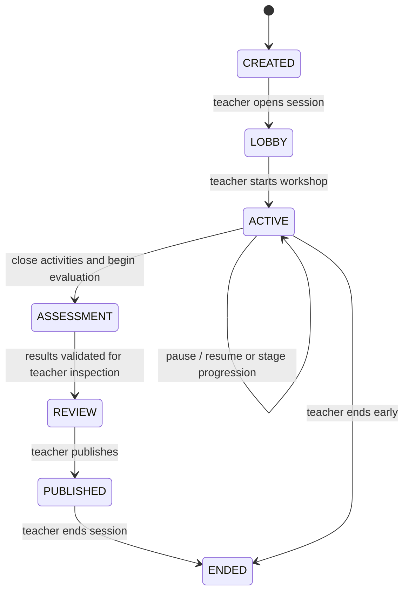
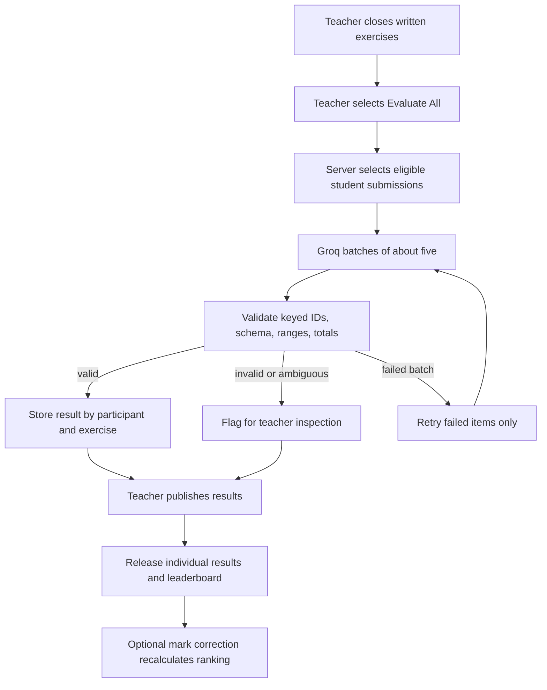

# Words Connect — User Workflows

## Session lifecycle

Lifecycle state is authoritative on the server. Only one active workshop session is supported; there is no multi-classroom or multi-session management. Opening the main application link enters the teacher interface directly, without a password/access code or permanent account. The teacher capability remains scoped to the active session. Joining is independently open or closed and remains open after the workshop starts until the teacher closes it. Activity-specific submission gates also remain server-controlled.

Implemented in Task 004: the lifecycle begins at `LOBBY`, changes to `ACTIVE` when the teacher starts, and changes to `ENDED` when the teacher ends. The teacher can open/close joining independently. Ending closes joining and retains the in-memory session; it does not clear it. This foundation has no export or clear control, and an ended session prevents creating another session until process restart. The remaining lifecycle states and activity workflows in the diagram are planned behavior.

## Student journey

1. Student opens the QR code or joining link. The server checks that joining is open and creates or reconnects a participant.
2. Student enters a display name. The server assigns an opaque participant ID and session display number (for example, 01); neither is a permanent identity.
3. The student lands in the shared Word Universe stage and sees their participant number. Before the teacher starts, the Start Learning action shows a waiting state. Once the lifecycle is `ACTIVE`, the student may request the first-stage transition. The backend validates the authenticated participant and updates the shared `currentStage`; student navigation cannot skip ahead locally.
4. **Wall:** on entering the active Wall, submissions open. A student submits one 10–200 character kind message, which appears immediately and anonymously; the server stores the author association privately. The message cannot be edited or replaced, including after teacher deletion. Deleted messages disappear from the public Wall and cannot be selected for Remix. Teacher-authored messages appear immediately but are not student submissions.
5. **Learn / Paraphrase Lab:** student opens any of three floating bubbles in any order, reads its fixed example, and closes it to explore another. Bubble selection is local to that learner and the activity is ungraded. The teacher sees the same activity and explores it independently; there is no shared demonstration control.
6. **Pit Stop:** student reads the exact mission sentence and submits one answer for each of the three fixed questions while open. The first accepted answer per question is immutable; retries return that answer. Correct answers and explanations remain hidden until the teacher closes and reveals the quiz. The student then sees the quiz score out of three.
7. **Remix Studio:** teacher selects an available student Wall message or exactly: “Your kindness makes our class a more welcoming place, and your positive attitude encourages everyone.” Source selection may change before Message Remix first opens; after opening, its source stays fixed. Students see the same source and submit one immutable Message Remix response. Separately, students paraphrase exactly: “Regular participation in extracurricular activities can improve university students' social skills and contribute to their personal development.” Its submission gate and response are independent from Message Remix.
8. **Insights:** before publication, results and rankings are unavailable. After publication, student sees their quiz score, both writing scores, final score, feedback, and published leaderboard.
9. Student may reconnect with the session token and resumes the same participant identity and last successfully saved submissions.

## Teacher live journey

1. Teacher opens the main application link and enters the teacher interface directly. The app opens or reuses the one supported workshop session, and the teacher shares its joining QR/link. The QR/link opens the student name-entry flow and grants participant identity only. No password, access code, permanent teacher account, or multiple-session manager is used. Teacher can close joining at any time; no new participant is accepted afterward, while existing participants may reconnect.
2. Teacher sees the same activity stage as students. Directly below it, the stage-specific teacher panel provides controls.
3. **Welcome:** open/close session and joining, show QR/link, view student participant count. Teacher demonstration interactions are excluded from student records.
4. **Wall:** stop/reopen submissions, delete inappropriate student messages, and privately identify an author if necessary. Student messages are public as soon as submitted, and each student may submit only one, even if it is later deleted. Deleted messages are unavailable for Remix selection. Teacher-authored content is internally marked and excluded from student counts.
5. **Learn:** explore the same three-bubble activity students see. Bubble selections remain local to the teacher's screen; there are no Stage 2 presentation controls and no marks are awarded.
6. **Pit Stop:** open quiz, monitor submitted/not submitted status, close quiz, reveal fixed answers and explanations, then progress. Closing prevents later answers; reveal occurs only after close.
7. **Remix Studio:** view available Wall messages, choose a message or fallback before submissions first open, open/close the two gates independently, and monitor separate submission counts. Academic Transfer always uses its fixed source.
8. **Assessment:** click Evaluate All. Server assesses eligible submitted student work in small batches and reports progress/failures. An exercise with no accepted response at closure is assigned zero without an AI request. Failed assessment work is retried; if it remains unresolved, the result stays flagged and publication is blocked until resolved, preventing accidental publication of incomplete results. Teacher reviews flagged cases as needed; full manual review is not required. Teacher clicks Publish Results only when all submitted work is resolved.
9. **Insights:** inspect class performance and individual details. For a dispute, use Check Student Results to inspect sources, response, criterion scores, and AI feedback. Teacher may change marks only; feedback is immutable. Corrections immediately recalculate final score and leaderboard.
10. Independently choose whether to download CSV/JSON and whether to clear in-memory session data. Ending the session does not automatically download or clear data; both choices are explicit and independent.

## Teacher preview journey

Teacher enters a clearly labeled Preview mode and supplies a demo name. It uses the same stage visuals and interactions with sample/demo data across all stages. Preview may demonstrate answer, message, and writing interactions but writes only to isolated demo state. The preview must not create a live participant, change counts, send student submissions, call Groq, affect scores/leaderboards, or publish sample results as real outcomes. Exiting preview returns to live teacher mode without altering the session.

The current local preview is available from the unauthenticated development entry page and is client-only. It does not open a session socket or create a participant. The full demo interactions and live-teacher preview journey remain future work.

## Quiz submission and duplicate policy

The client submits a question ID and selected option with its authenticated participant credential and an idempotency key. The server verifies the quiz is open, the participant belongs to this session, and the question/option are valid. The first accepted answer per participant/question is immutable for this run; any duplicate retry returns the original acknowledgement and cannot create a duplicate or change the accepted answer. This gives reconnect/retry safety. The teacher sees status, not answers, before closure. Answer keys/explanations are sent only after the teacher closes and reveals them.

## Assessment and publication workflow

Teacher correction changes marks only. The server recalculates the final score and emits the updated published result and leaderboard atomically.

## Session ending

Teacher requests end. The server stops accepting activity writes and marks the session ENDED. The teacher independently chooses whether to download results and whether to clear in-memory session data; either, both, or neither may be chosen. Ending alone does not automatically download or delete data. Data disappears on server restart regardless, as persistence/recovery is out of scope.

